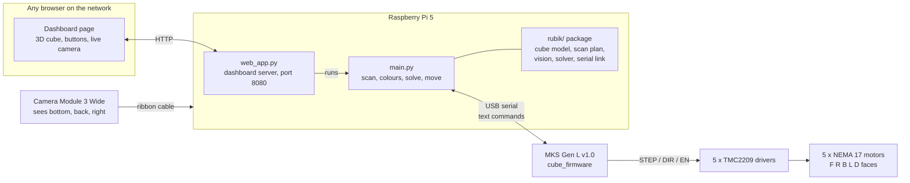
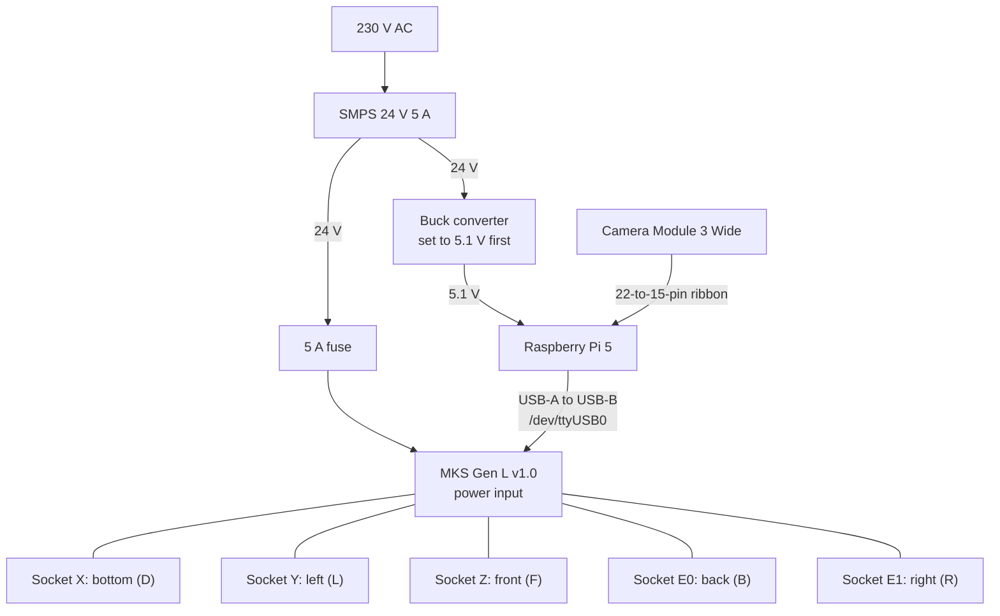
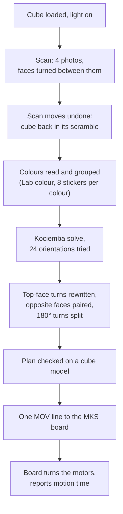

# Rubik's cube solver robot (TA6)

## Watch it solve

[](https://www.youtube.com/watch?v=wnTuuExPoho)

*Click the picture to play the video on YouTube.*

A robot that reads a scrambled Rubik's cube with one camera and solves it with
five stepper motors.

- **Raspberry Pi 5** with a **Camera Module 3 Wide** reads the cube, works out
  the solution (Kociemba's two-phase algorithm) and plans every move.
- **MKS Gen L v1.0** board with five **TMC2209** drivers turns five faces
  (front, right, back, left, bottom) with **NEMA 17** motors.
- **The top face has no motor.** The software rewrites every top-face turn
  into turns of the other five faces, and uses the motors to bring stickers the
  camera can't see into view.
- **Goal:** solve in under 2 s, counted after the scan. The scan isn't timed.
- **Dashboard:** a web page served by the Pi lets you scramble, read and solve
  the cube from any browser, with a 3D cube and a live camera view.

---

## Contents

1. [How it all comes together](#how-it-all-comes-together)
2. [Hardware](#hardware)
3. [How a solve works, step by step](#how-a-solve-works-step-by-step)
4. [What every file does](#what-every-file-does)
5. [Setting it up](#setting-it-up)
6. [Using it](#using-it)
7. [Configuration](#configuration)
8. [Tests](#tests)
9. [Older parts of the project](#older-parts-of-the-project)

---

## How it all comes together



1. **You press a button** on the dashboard, or run `python main.py …` on the Pi.
2. **`main.py` scans the cube:** it takes photos, and between photos asks the
   MKS board to turn faces so every sticker is seen once. Then it turns them
   back.
3. **The colours are read** from the photos and turned into the cube's state.
4. **The solver** finds a solution and turns it into motor steps that never use
   the top face.
5. **The whole solution goes to the MKS board in one line.** The board drives
   the five motors and reports how long the motion took.

---

## Hardware

### Parts

| Part | Used for | Notes |
| --- | --- | --- |
| Raspberry Pi 5 | Runs everything: camera, colours, solver, dashboard | Raspberry Pi OS 64-bit (desktop) |
| Camera Module 3 Wide | Reads the stickers | On the Pi 5's camera port with the 22-to-15-pin cable |
| MKS Gen L v1.0 (ATmega2560) | Turns the motors | Runs `firmware/cube_firmware`; USB to the Pi |
| 5 × BIGTREETECH TMC2209 v1.3 | Stepper drivers | Standalone mode: no UART wires, **no MS jumpers** (1/8 microstepping), current set with **Vref ≈ 1.9–2.0 V** |
| 5 × NEMA 17 JK42HS48-1684 | Turn the faces | 1.8° per step, 1.68 A |
| 24 V 5 A power supply (SMPS) | Powers the MKS board and motors | |
| 5.1 V buck converter | Powers the Pi from the 24 V supply | Must deliver 5 A |
| Frame | Holds motors, cube and camera | Mild steel motor plates on a 2020 aluminium extrusion frame, 3D-printed plate brackets |
| Centre adapters | Connect each motor shaft to a face centre | 3D-printed |
| Lighting | Even light on the cube | White LEDs behind a diffuser; keep daylight out |

### Wiring



Each driver socket on the MKS board drives one face. Which socket drives which
face is set by the pin numbers in
[`firmware/cube_firmware/config.h`](firmware/cube_firmware/config.h):

| MKS socket | Face | STEP | DIR | EN |
| --- | --- | --- | --- | --- |
| X | D (bottom, yellow) | D54 | D55 | D38 |
| Y | L (left, orange) | D60 | D61 | D56 |
| Z | F (front, green) | D46 | D48 | D62 |
| E0 | B (back, blue) | D26 | D28 | D24 |
| E1 | R (right, red) | D36 | D34 | D30 |

- There's **no motor on the top (U, white) face**.
- Each motor must turn its face **90° clockwise, as seen from outside that
  face**, for `MOV F`, `MOV R`, and so on. Fix one that turns the wrong way with
  its `*_INVERT` flag in `config.h`.
- The Z socket has two motor connectors in parallel; use only one.
- Never plug or unplug a motor while the board is powered.
- Full details, including the optional TMC2209 UART wiring:
  [`docs/wiring.md`](docs/wiring.md).

### Camera position

The camera sits at the **back-bottom-right corner** of the cube, looking at the
corner where the bottom, back and right faces meet. It sees those three faces,
but not their centres (the motor adapters cover them) or a few stickers hidden
by the rods. Glare also makes two far edge stickers per face unreliable, so the
scan reads **15 stickers per photo**:

| Face | Read | Not read |
| --- | --- | --- |
| R (red) | R3 R6 R7 R8 R9 | R2 R4 (glare), R1 (behind a rod) |
| B (blue) | B1 B4 B7 B8 B9 | B2 B6 (glare), B3 (behind a rod) |
| D (yellow) | D3 D6 D7 D8 D9 | D2 D4 (glare), D1 (behind a rod) |

Where each sticker is in the picture is hard-coded in
[`pi/data/face_model.json`](pi/data/face_model.json): seven face corners and the
lens bend, fitted to a photo of the robot
([`docs/face_quads.jpg`](docs/face_quads.jpg)). Nothing has to be clicked by hand.

### Loading the cube

Load it the same way every time: **white on top, green at the front** by
default. The centres are never read, so this is how the program knows which
colour belongs to which face. To load it another way, set `[cube] top` and
`front` in `pi/config.toml`; the colour calibration is remapped automatically.

---

## How a solve works, step by step



**1. Scan (not timed).** The camera sees only 15 stickers at a time, so the
robot takes **4 photos**, turning faces between them so every one of the 48
movable stickers is seen once:

```
scan plan: 4 photos, 12 moves: (as loaded) | R B' F' R | R F' D B' | L' D B R'
```

Every turn is a known reshuffle, so each reading is traced back to where that
sticker was in the original scramble. Four is the minimum here: a turn never
moves an edge sticker to a corner spot, and each photo shows only 6 of the 24
edge stickers. The plan is searched once and saved in
[`pi/data/scan_plans.json`](pi/data/scan_plans.json). After the last photo,
**every scan move is undone**, so the cube is back in exactly the scramble it
was given. If the scan stops early, the moves made so far are undone.

**2. Colours.** Each sticker is read from the middle 40 % of its outline in the
photo: the **median** colour, in **CIELAB** (Lab), with blown-out glare pixels
dropped. The 48 readings are then grouped into 6 groups of exactly 8
(equal-size k-means, starting from the calibrated colours), so each scan
follows its own lighting. Each group is named after the calibrated colour it's
closest to. If the result isn't a possible cube, other namings are tried. The
cube's state comes out as a 54-letter string in URFDLB order.

**3. Solve (timed, target under 2 s with the motion).** Kociemba's two-phase
algorithm finds a solution of about 20 moves. Then:

- **Best orientation:** the cube is tried in all 24 orientations, keeping the
  answer that is fastest for the robot.
- **No top face:** every U turn becomes `Y D Y`, where `Y = R L' F2 B2 R L'`
  (Y undoes itself). This identity is checked every time the program starts.
- **Pairs:** opposite faces that follow each other turn at the same time
  (`R+L'`).
- **90° only:** every 180° turn becomes two 90° turns.
- **Safety check:** the plan is played on a cube model before anything moves.

**4. Motion (timed).** The whole solution goes to the MKS board as one
`MOV …` line. The firmware writes the step pins directly, uses a precomputed
speed ramp, can turn two opposite faces at once, can go a little past 90° and
back ("overshoot") so stiff layers seat, and replies with the measured motion
time.

At the end `main.py solve` prints:

```
scan 9.80 s (not timed)
software  0.420 s   (solver, target < 2 s)
physical  2.300 s   (firmware-measured motion, target < 2 s)
```

*(example numbers)*

---

## What every file does

### `pi/`: the program on the Raspberry Pi

| File | What it does |
| --- | --- |
| [`main.py`](pi/main.py) | The command-line program: scan, calibrate, read, solve, move, test. Every command is listed under [Using it](#using-it). With `--json` it ends with one `RESULT {…}` line for the dashboard. |
| [`config.toml`](pi/config.toml) | All settings: serial port, camera, motor speed, scan, solver, calibration, how the cube is loaded. See [Configuration](#configuration). |
| [`web_app.py`](pi/web_app.py) | The dashboard server (port 8080). Each button runs `main.py`. Allows one command at a time, and remembers the last cube read. `--fake-robot` gives a pretend robot and camera for testing. |
| [`web/index.html`](pi/web/index.html) | The dashboard page: 3D cube, Scramble / Read / Solve, click modes, motors, colour calibration, live camera. |
| [`live_feed.py`](pi/live_feed.py) | The dashboard's live camera feed, with optional face outlines. Opens the camera only while someone watches, and hands it to `main.py` during scans. |
| [`exposure_sweep.py`](pi/exposure_sweep.py) | Takes a photo for every ISO × shutter speed × white balance combination, with outlines drawn. Saves contact sheets and a CSV, to help pick camera settings. |
| [`run_ui.sh`](pi/run_ui.sh) | Starts the dashboard with the project's Python environment. |
| [`rubik-ui.service`](pi/rubik-ui.service) | systemd service, to start the dashboard when the Pi boots. |
| [`requirements.txt`](pi/requirements.txt) | pip packages: `kociemba`, `pyserial`, `pytest`. Camera, OpenCV, numpy and scipy come from apt. |
| [`data/face_model.json`](pi/data/face_model.json) | Where each sticker is in the camera picture (face corners and lens bend). |
| [`data/rois.json`](pi/data/rois.json) | The older, clicked sticker positions (used only if `sticker_source = "rois"`). |
| [`data/scan_plans.json`](pi/data/scan_plans.json) | Saved scan plans, so the 4-photo plan loads instantly. |
| `data/colours.json` | Created by `calibrate-colours`: one reference colour per face, plus the orientation and camera settings it was made with. Not in the repository. |
| `logs/` | Photos of every scan (`logs/<date-time>/`) and of the last calibration (`logs/calib/`). Not in the repository. |

### `pi/rubik/`: the building blocks

| File | What it does |
| --- | --- |
| [`cube.py`](pi/rubik/cube.py) | The 54-sticker cube model in Kociemba's URFDLB order. Move permutations come from 3D geometry. Also the 24 whole-cube orientations, the cube printed as a net, and the face colours for a given loading orientation. |
| [`moves.py`](pi/rubik/moves.py) | Move lists: parsing, simplifying, inverting, the no-top-face rewrite (`U = Y D Y`), pairing opposite faces (`R+L'`), and splitting 180° turns. |
| [`scan_planner.py`](pi/rubik/scan_planner.py) | Works out which faces to turn between photos so every sticker is seen: a 2-photo search when half the stickers are readable, otherwise a search for the fewest photos possible, with a greedy fallback. Saves plans to `scan_plans.json`. |
| [`face_model.py`](pi/rubik/face_model.py) | Turns the face model into sticker outlines and sample areas in the picture, at any image size. |
| [`vision.py`](pi/rubik/vision.py) | Camera control (fixed or automatic ISO, shutter, white balance and focus), sampling each sticker, colour calibration (solved or scrambled cube), per-scan colour grouping, saving and loading the reference colours. |
| [`solver.py`](pi/rubik/solver.py) | Runs Kociemba in the 24 orientations, rewrites and pairs the moves, and checks the plan on the cube model. |
| [`serial_link.py`](pi/rubik/serial_link.py) | The USB link to the firmware: `MOV`, `JOG`, `SPEED`, `SETTLE`, `OVERSHOOT`, `SHAKE`, motors on/off. |
| [`config_edit.py`](pi/rubik/config_edit.py) | Writes values back into `config.toml` (used to save the camera settings after calibration) without touching anything else in the file. |

### `pi/tests/`: unit tests (no hardware needed)

| File | Covers |
| --- | --- |
| [`test_core.py`](pi/tests/test_core.py) | Cube model, move rewrite, scan plans, colour calibration and the whole pipeline with simulated colours |
| [`test_orientation.py`](pi/tests/test_orientation.py) | Loading the cube in any orientation, and remapping the calibration |
| [`test_adaptive_colours.py`](pi/tests/test_adaptive_colours.py) | Per-scan colour grouping under changed light |
| [`test_camera_settings.py`](pi/tests/test_camera_settings.py) | Fixed ISO / shutter / white balance and the calibration check |
| [`test_config_edit.py`](pi/tests/test_config_edit.py) | Writing camera settings into `config.toml` |
| [`test_face_model.py`](pi/tests/test_face_model.py), [`test_rois.py`](pi/tests/test_rois.py) | Sticker positions and sampling |
| [`test_scan_undo.py`](pi/tests/test_scan_undo.py) | The cube always returns to its scramble after a scan, even when the scan stops |
| [`test_web_app.py`](pi/tests/test_web_app.py) | Every dashboard button, with a pretend robot |
| [`test_live_feed.py`](pi/tests/test_live_feed.py) | The live camera feed (needs OpenCV) |

### `firmware/`: programs for the MKS Gen L

| Sketch | What it does |
| --- | --- |
| [`cube_firmware/`](firmware/cube_firmware) | **The robot's firmware.** Receives text commands from the Pi over USB (115200 baud) and turns the five faces: direct port writes, precomputed speed ramp, paired opposite faces, overshoot, shake. Version 1.4. Settings and pins are in `config.h`; commands are in [`docs/protocol.md`](docs/protocol.md). |
| [`motor_test/`](firmware/motor_test/motor_test.ino) | Test one motor at a time from the Serial Monitor, e.g. `X 400` (400 steps = 90°). No libraries. |
| [`speed_test/`](firmware/speed_test/speed_test.ino) | Find how fast the motors can go: timer-driven step pulses and a speed sweep. No libraries. |
| [`stepper_test/`](firmware/stepper_test/stepper_test.ino) | Turns each motor one full turn using the AccelStepper library. |

The three test sketches **replace** the robot's firmware when uploaded. Upload
`cube_firmware` again before using the Pi program.

### `docs/`

| File | What it covers |
| --- | --- |
| [`SETUP.md`](docs/SETUP.md) | **The full setup guide**, from a blank SD card to a timed solve, with checks after every part and a troubleshooting table |
| [`wiring.md`](docs/wiring.md) | Motor sockets and pins, optional TMC2209 UART wiring, power and camera |
| [`protocol.md`](docs/protocol.md) | Every serial command between the Pi and the MKS board |
| [`web_ui.md`](docs/web_ui.md) | The dashboard: buttons, click modes, live camera, calibration |
| [`face_quads.jpg`](docs/face_quads.jpg) | The reference photo the face model was fitted to |

---

## Setting it up

The complete guide is **[docs/SETUP.md](docs/SETUP.md)**. In short:

1. **Firmware:** in the Arduino IDE, install TMCStepper, open
   `firmware/cube_firmware/cube_firmware.ino`, choose *Arduino Mega or Mega
   2560*, and upload. The Serial Monitor (115200 baud, Newline) shows
   `READY rubik-fw 1.4`. Check every face turns clockwise with `MOV F`, `MOV R`, …
2. **Raspberry Pi OS (64-bit, desktop)**, with SSH and VNC on.
3. **Python environment on the Pi:**
   ```bash
   sudo apt install -y python3-picamera2 python3-opencv python3-numpy python3-scipy python3-dev libffi-dev build-essential
   cd rubiks-solver/pi
   python3 -m venv --system-site-packages .venv
   source .venv/bin/activate
   pip install -r requirements.txt
   python -m pytest -q             # unit tests
   python main.py simulate -n 20   # whole pipeline without hardware
   ```
4. **Link to the MKS:** plug it into the Pi's USB, then `python main.py ping`.
5. **Light and camera:** enclose the robot, light it evenly, and check the face
   outlines with `python main.py show-faces`.
6. **Colour calibration:** load the cube solved (white on top, green at the
   front) and run `python main.py calibrate-colours`. It also saves the camera
   settings it chose into `config.toml`, so every later run sees the same
   colours.
7. **Speed tuning:** `python main.py bench --speed 8000 --accel 250000`. Raise
   the values until turns skip, then back off about 15 %.

---

## Using it

### From a browser: the dashboard

```bash
cd ~/rubiks-solver/pi && ./run_ui.sh
```

Open `http://<pi-ip>:8080`. Every button runs `main.py`, and every move is
shown on the 3D cube first, then turned by the robot.

| On the page | What it does |
| --- | --- |
| **1 Scramble** | Random moves (F R B L D only), shown, then turned by the robot |
| **2 Read cube** | Scans the cube and shows the state read on the 3D cube |
| **3 Solve cube** | Finds the solution (reading first if needed), shows it, then the robot turns it, with times |
| **Mode 1 · Live** | Click a face of the 3D cube: it turns, then the robot turns it |
| **Mode 2 · Record** | Clicks build a move string; **Send to robot** sends it all |
| **Colour calibration** | Calibrates the colours with the cube solved or scrambled; shows the closest colour pairs |
| **Live camera** | The camera's view with the face outlines; pauses itself during scans |
| **Motors on / off** | Holds or releases all faces |

More: [`docs/web_ui.md`](docs/web_ui.md). To start it on boot, see
[`pi/rubik-ui.service`](pi/rubik-ui.service).

### From the command line (on the Pi, in `pi/`)

| Command | What it does |
| --- | --- |
| `python main.py simulate` | Whole pipeline on random cubes, no hardware |
| `python main.py ping` | Checks the link to the MKS board |
| `python main.py move "R D' F2"` | Turns faces exactly as typed (no U) |
| `python main.py jog F 10` | Nudges one motor by microsteps, to line up an adapter (400 = 90°) |
| `python main.py shake` | Wiggles the faces so a stiff cube settles |
| `python main.py motors on` / `off` | Holds or releases all motors |
| `python main.py show-faces` | Draws the face outlines on a photo, to check the camera |
| `python main.py calibrate-colours [--scrambled]` | Records the face colours and saves the camera settings |
| `python main.py read` | Scans and prints the cube (the cube ends as it was loaded) |
| `python main.py solve --dry-run` | Scans and solves, prints only |
| `python main.py solve` | Scans, solves and turns the solution, with times |
| `python main.py solve --state <54 letters>` | Solves a known state without scanning |
| `python main.py bench --speed 8000 --accel 250000` | Times the motors for speed tuning |
| `python exposure_sweep.py` | Photos at many ISO, shutter and white balance settings |
| `python web_app.py --fake-robot` | The dashboard with a pretend robot and camera, on any computer |

---

## Configuration

Everything is in [`pi/config.toml`](pi/config.toml):

| Section | What it sets |
| --- | --- |
| `[cube]` | How the cube is loaded: the colour on top and the colour at the front |
| `[serial]` | USB port of the MKS board (`/dev/ttyUSB0`) |
| `[camera]` | Resolution, field of view, focus, and the fixed `iso` / `shutter` / `white_balance` (written by calibration) |
| `[motion]` | Top speed, acceleration, pause after each move, paired opposite faces, 90°-only turns, overshoot |
| `[shake]` | Shake size and count, and whether to shake before the scan or the solve |
| `[scan]` | Which stickers are read, where their positions come from, per-scan colour grouping, pause between scan turns |
| `[solver]` | Trying the 24 orientations, and the time allowed for it |
| `[calibration]` | Calibration pace (pause and key press per turn), letting the camera choose its settings, saving them |
| `[files]` | Where sticker positions, colours, the face model and scan plans are kept |

---

## Tests

```bash
cd pi && python -m pytest -q
```

The 124 tests run without any hardware and take about a minute. Some of them
search for scan plans. The live-camera tests are skipped where OpenCV isn't
installed.

---

## Older parts of the project

This repository also holds an earlier version of the project (TA6, from
`mepk1001`), kept for reference. The Pi dashboard above replaces it.

| Folder / file | What it is |
| --- | --- |
| [`laptop_server/`](laptop_server) | A dashboard that runs on a laptop (port 8010): 3D cube, scrambles and solutions, which asks the Pi to solve. It can't turn the motors. Started with `start_server.ps1`. |
| [`raspberry_pi/solver_app.py`](raspberry_pi/solver_app.py) | The Pi solver API for that dashboard (port 8011), using a bundled pure-Python Kociemba (`raspberry_pi/vendor/`, not in the repository) |
| [`raspberry_pi/robot_executor.py`](raspberry_pi/robot_executor.py) | Sends a solution from that API to the MKS board, using the same no-top-face rewrite (dry run unless `--execute`) |
| [`raspberry_pi/camera_scan.py`](raspberry_pi/camera_scan.py), [`client.py`](raspberry_pi/client.py) | An early camera scaffold and a small client for the solver API |
| [`raspberry_pi/setup.sh`](raspberry_pi/setup.sh), [`run_solver.sh`](raspberry_pi/run_solver.sh) | Set up and start the solver API |
| [`server/`](server) | An earlier laptop-only solver API |
| [`index.html`](index.html) | A static copy of the old dashboard page |

How to run them is in [`docs/SETUP.md`](docs/SETUP.md), part 10 ("Older laptop
dashboard").
